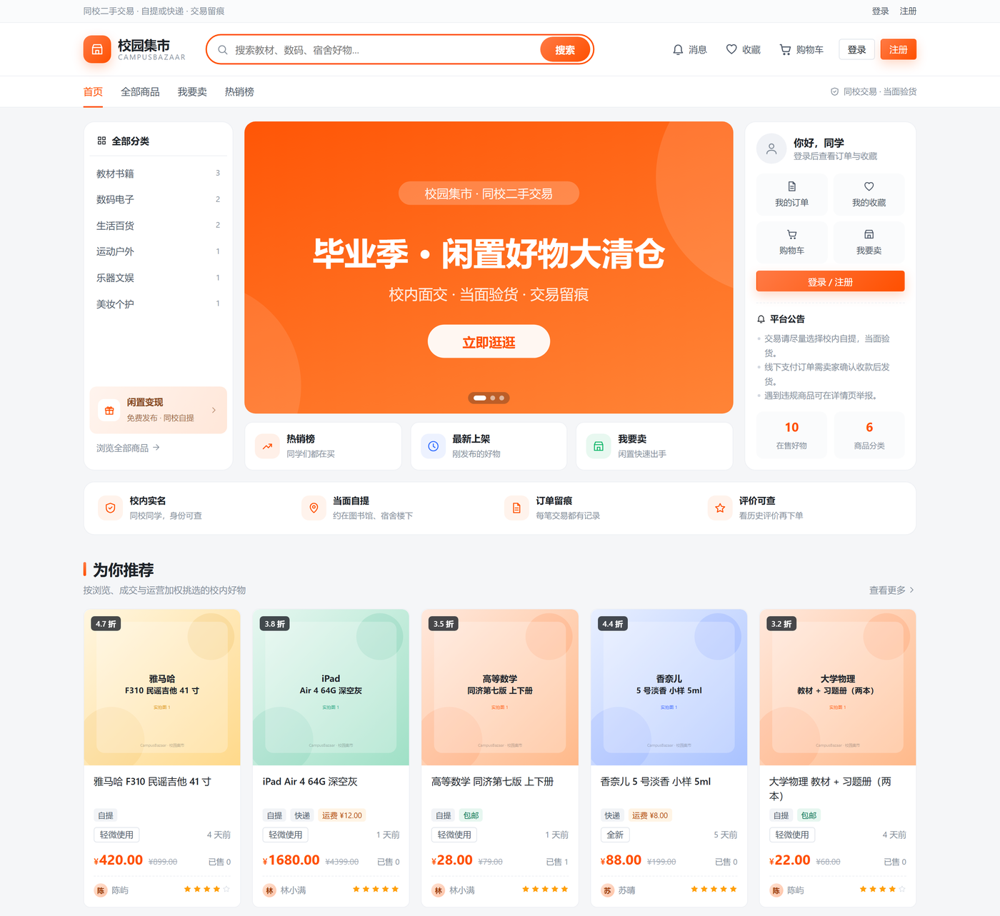
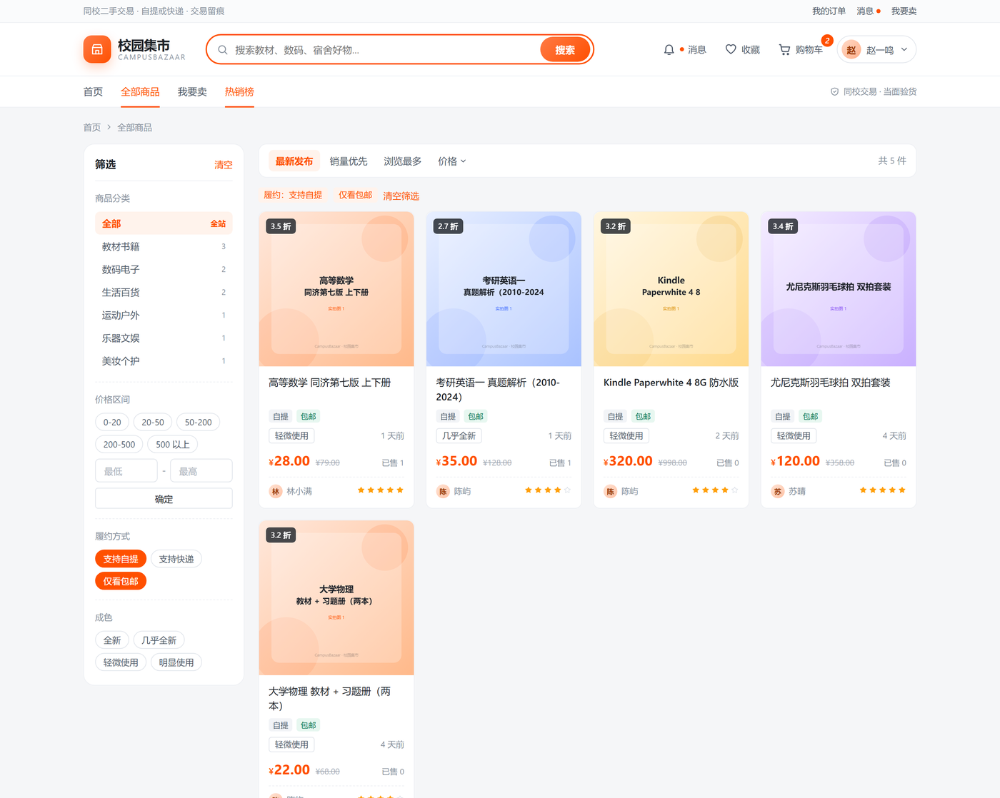
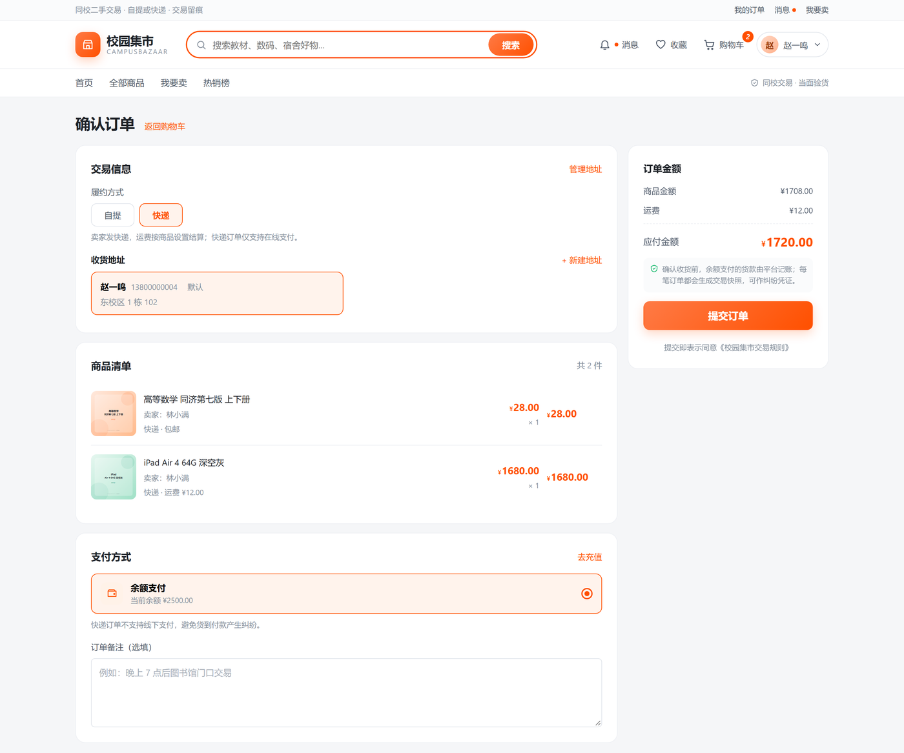
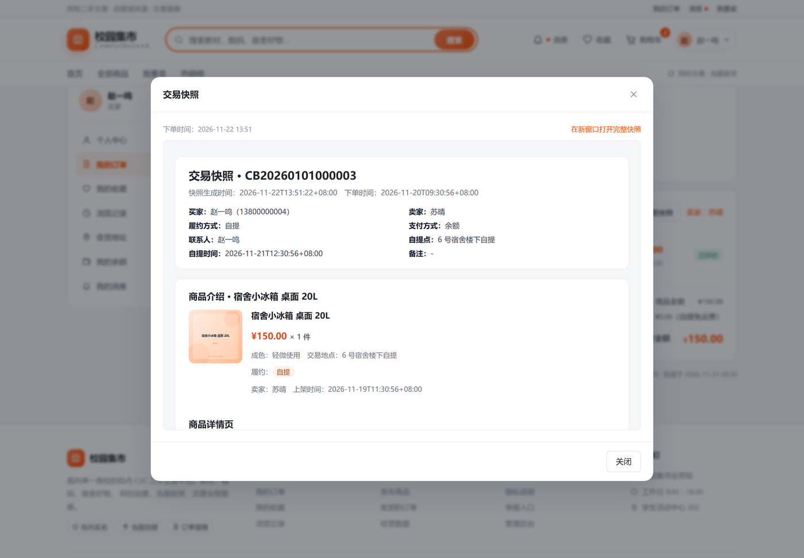
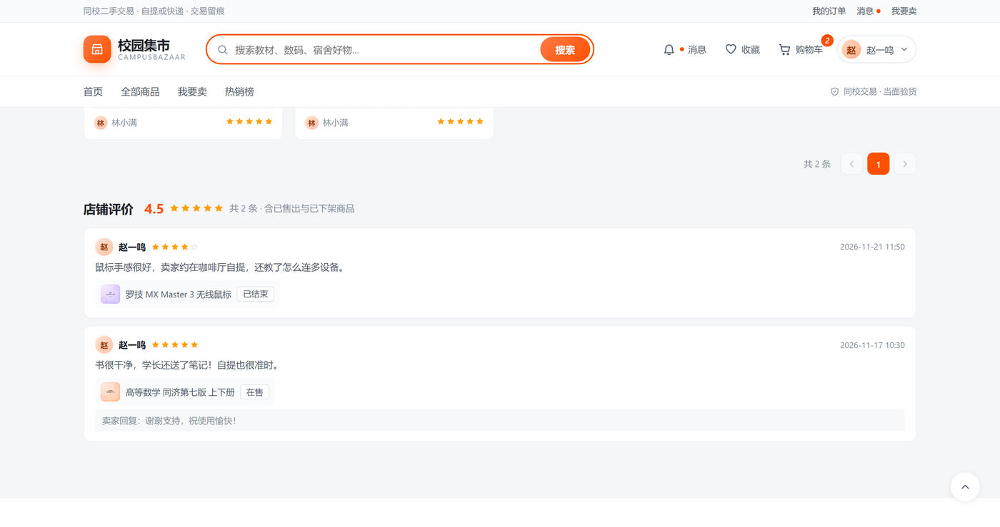
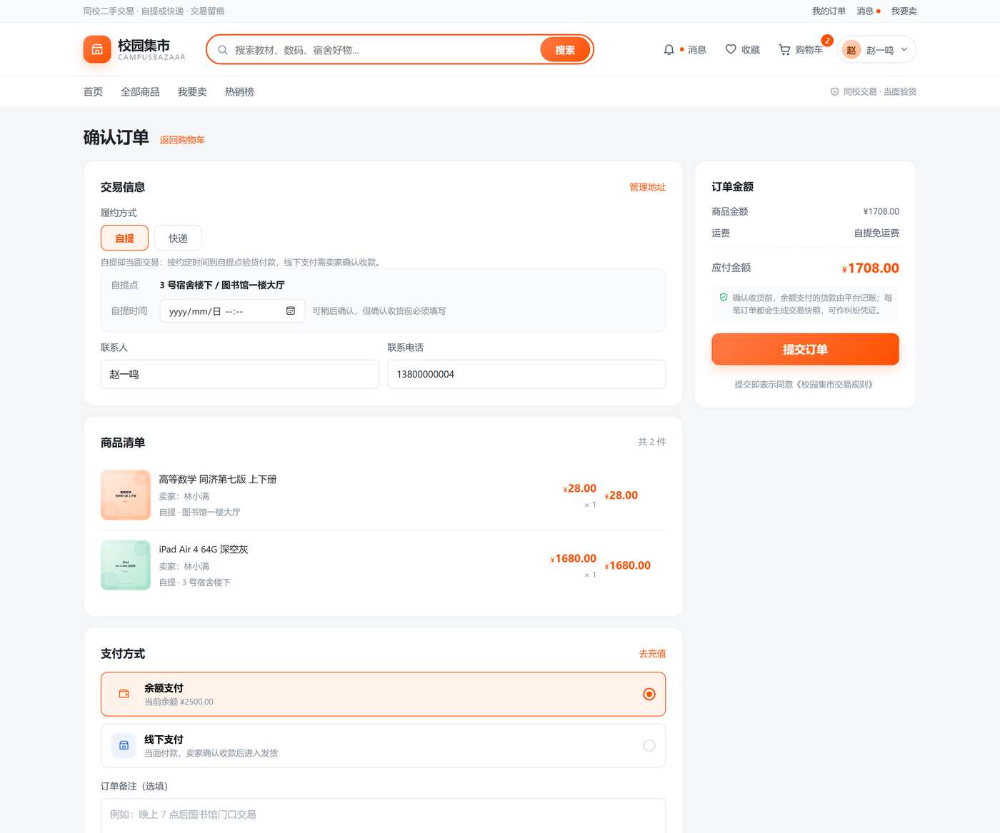
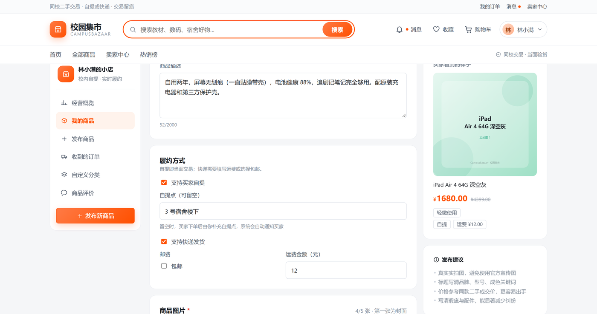
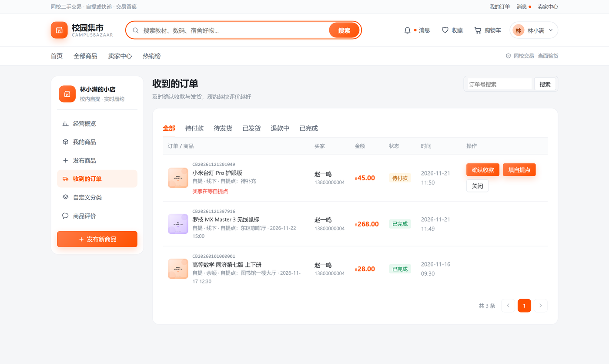
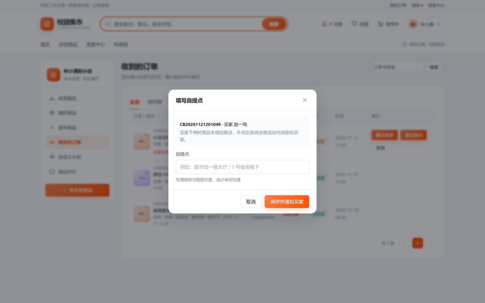
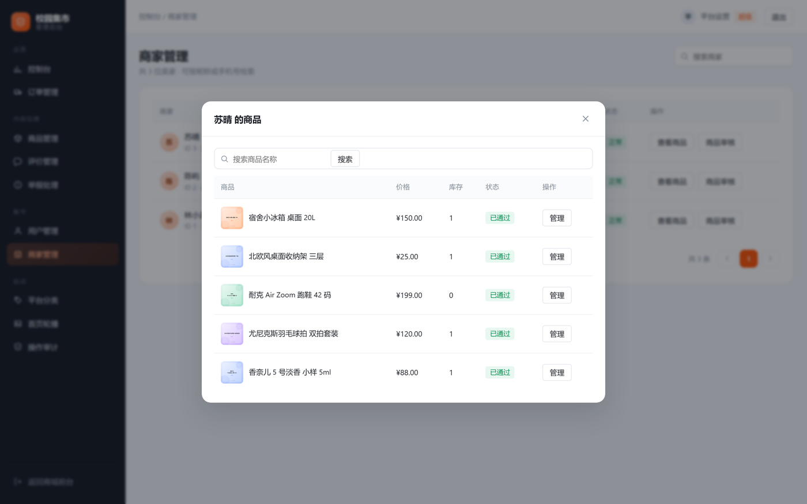

# 校园集市 CampusBazaar

面向单一高校的校内 C2C 二手交易平台：学生既是买家也可以是卖家，平台提供**发布 → 检索 → 下单 → 支付 → 履约 → 评价**的完整闭环，并对内容与交易做基础治理。

- 后端：Flask 3 + SQLAlchemy 2 + Alembic（SQLite 本地 / MySQL 生产）
- 前端：Vue 3 + Vite + Pinia（无 UI 框架依赖，自建设计系统）
- 本地零外部依赖：一条命令自动建库、灌演示数据、生成演示图片

> 需求基线： [`docs/00-需求规格说明书.md`](docs/00-需求规格说明书.md)（PRD v2.2，正文条目自 v2.0 冻结，增量以附录 E 变更单追加）。本仓库为按其重写的实现，逐条落地状态见 [`docs/04-需求追踪矩阵.md`](docs/04-需求追踪矩阵.md)。

---

## 1. 功能概览

| 角色 | 能力 |
| --- | --- |
| 游客 | 首页轮播/分类/推荐、搜索筛选（含自提/快递/包邮）、商品详情与评价、店铺主页（含历史评价） |
| 买家 | 注册登录、收藏、浏览记录、购物车、下单（自提/快递，运费自动计入）、支付、取消、确认收货、退款申请、评价、消息、地址、余额与流水 |
| 卖家 | 一键开通卖家、发布/编辑/上下架/删除商品、多图上传、自定义分类、声明自提点与运费、补录自提点、确认收款、发货、处理退款、经营看板、回复评价 |
| 管理员 | 独立登录与锁定、控制台数据、用户封禁/解封/重置密码、商家与商品审核（列表内直接管理）、批量通过/下架、评价隐藏、订单介入、平台分类、首页轮播、举报处理、操作审计、CSV 导出 |

### 界面速览

以下截图均为本地演示数据的真实页面（`python -m backend.dev --serve-dist` 后实拍），非设计稿。

| 首页 · 分类导航与推荐位 | 商品浏览 · 自提/快递/包邮筛选 |
| :--: | :--: |
|  |  |

| 商品详情 · 履约与运费写明 | 确认订单 · 快递只走地址簿、运费计入 |
| :--: | :--: |
|  |  |

| 订单交易快照 · 纠纷取证 | 店铺主页 · 全部历史评价 |
| :--: | :--: |
|  |  |

关键机制：

- **双分类体系**：平台分类（买家怎么找）+ 卖家私有分类（卖家怎么管）
- **履约方式**：`自提`（卖家发布时声明自提点，可补录并通知买家；买家确认时锁定自提时间，可线下支付）/ `快递`（只走地址簿、只允许余额支付，按卖家设置计运费或包邮）
- **交易快照**：下单即生成自包含 HTML 快照（含商品介绍图与详情信息，图片内联），供纠纷取证，不受商品后续编辑/下架影响
- **订单状态机**：待付款 → 已付款 → 已发货 → 已完成，含退款中/已取消分支，非法迁移返回 409 并写流水
- **库存并发安全**：条件更新 `UPDATE ... WHERE quantity >= n`，影响行数为 0 即库存不足
- **幂等下单**：`Idempotency-Key` 10 分钟内重复提交返回首次结果
- **鉴权语义**：401 仅表示未认证，403 表示已认证无权限；用户令牌与管理令牌完全隔离
- **审计留痕**：审核、下架、封禁、隐藏评价、退款处理全部落 `audit_logs` + 安全日志

### 1.1 检索：按履约方式与包邮筛选

买家不必点进详情就能判断「能不能拿到手」：侧栏支持「支持自提 / 支持快递 / 仅看包邮」三个筛选，商品卡片直接带自提、包邮、运费小标。

### 1.2 商品详情：履约与运费写清楚

详情页把两种履约方式并列展示——自提点写在哪里、快递收多少运费、是否包邮，一眼可见，避免下单后才发现要跑一趟。

### 1.3 结算：自提与快递是两套表单

选「自提」只填自提点、自提时间与联系人，可线下支付；选「快递」不再手填联系人/电话/地址，只从地址簿选择（超过 4 条转下拉），并且只允许余额支付，运费自动计入应付金额。商品清单里的履约信息随所选方式变化，不会在快递订单里冒出「校内自提」。



### 1.4 卖家发布：声明自提点，设置包邮或运费

发布/编辑商品时新增「履约方式」区块：自提点可留空（后续补录）、快递必须明确包邮或填运费，前后端双重校验。



### 1.5 卖家补录自提点

发布时没填自提点的商品，买家下单后卖家订单页会出现「买家在等自提点」提示与「填自提点」入口；保存后系统推送站内消息给买家。





### 1.6 订单交易快照

下单即固化商品介绍页与详情信息（图片内联进 HTML），商品后续改价、下架、删除都不影响这份凭证，纠纷时可作为取证依据。

### 1.7 店铺历史评价

店铺主页汇总该卖家的**全部**历史评价，包含已售出、已下架商品；带评分分布、商品跳转与卖家回复，方便新买家判断店铺口碑。

### 1.8 后台直接管理商品

商家管理 →「查看商品」弹窗内，每行商品都有「管理」按钮，改状态、写下架原因、设首页推荐都在弹窗内完成，不必跳到商品审核页再找一遍。



> 文中截图（速览 6 张 + 功能细节 5 张）全部由 `python scripts/capture_screenshots.py` 从本地实例实拍生成（无头浏览器 + 演示数据），改动界面后一条命令即可重拍。

## 2. 目录结构

```
CampusBazaar/
├── backend/                 # Flask 应用
│   ├── __init__.py          # 应用工厂：配置、扩展、日志、错误处理、蓝图装配
│   ├── config.py            # local / testing / staging / production 四套配置
│   ├── constants.py         # 全站枚举唯一来源（状态、支付方式、阈值）
│   ├── errors.py            # 统一错误模型与错误码
│   ├── models/              # 按领域拆分的 ORM 模型
│   ├── api/                 # 路由层：auth / public / cart / orders / seller / account / interactions
│   │   └── admin/           # 管理端路由：dashboard / users / sellers / products / comments / orders / catalog / moderation
│   ├── services/            # 业务规则：订单状态机、商品查询、统计、定时任务、DTO 序列化
│   ├── utils/               # 响应、鉴权、校验、日志、限流、幂等、验证码、图片、通知、审计
│   ├── seed.py              # 幂等演示数据 + 占位图生成
│   ├── dev.py               # 本地一键启动
│   └── wsgi.py              # 生产入口
├── frontend/                # Vue 3 前端
│   └── src/
│       ├── api/             # axios 客户端 + 领域接口封装
│       ├── stores/          # Pinia：auth / cart / app
│       ├── router/          # 路由与守卫（登录、卖家、管理员）
│       ├── styles/          # 设计令牌与基础样式
│       ├── components/      # UI 基件、布局、商品组件
│       ├── layouts/         # 商城 / 账户中心 / 卖家中心 / 管理后台
│       └── views/           # 页面
├── migrations/              # Alembic 迁移（初始版本已生成）
├── tests/                   # pytest：状态机、库存、权限、治理
├── scripts/                 # 冒烟测试、接口巡检、README 截图脚本
├── docs/                    # 需求、架构、运行验收、API 契约
├── alembic.ini
├── requirements.txt
└── pytest.ini
```

## 3. 快速开始

### 3.1 最小启动（后端 + 演示数据）

```bash
python -m venv .venv
source .venv/Scripts/activate      # Windows Git Bash；PowerShell 用 .venv\Scripts\Activate.ps1
pip install -r requirements.txt

python -m backend.dev              # 自动迁移 + 灌演示数据 + 启动 5000 端口
```

启动后：

- API：`http://127.0.0.1:5000/api`
- 健康检查：`http://127.0.0.1:5000/api/health`
- 本地验证码台账：`http://127.0.0.1:5000/dev/captchas`（生产模式自动 404）

### 3.2 前端开发（推荐日常使用）

```bash
cd frontend
npm install
npm run dev        # http://127.0.0.1:8080 ，/api 与 /static 已代理到 5000
```

### 3.3 单命令演示（构建产物由 Flask 托管）

```bash
cd frontend && npm run build && cd ..
python -m backend.dev --serve-dist     # 直接访问 http://127.0.0.1:5000
```

### 3.4 演示账号

首次启动会写入 `instance/demo-accounts.txt`（内含密码），终端也会打印。账号分布：

| 角色 | 手机号 / 账号 | 说明 |
| --- | --- | --- |
| 买家 | 13800000004 / 13800000005 | 有余额、有历史订单 |
| 卖家 | 13800000001 / 13800000002 / 13800000003 | 各有在售商品与订单 |
| 管理员 | admin（`/admin/login`） | 后台入口不在前台导航中 |

卖家同时也可以当买家下单；账号密码以 `instance/demo-accounts.txt` 为准。

## 4. 测试与质量门禁

```bash
# 单元 + 接口测试（内存 SQLite，39 个用例）
CAMPUS_CONFIG=testing pytest

# 端到端冒烟（真实 HTTP，53 项断言，含 AC-01~AC-14）
python scripts/smoke_test.py

# 全接口覆盖巡检（80 个请求，捕捉 500 与异常状态码）
python scripts/api_sweep.py

# 可选：无头浏览器截图巡检（需本机 Edge/Chrome）
python scripts/visual_check.py
```

合并前建议执行：

```bash
python -m compileall -q backend
cd frontend && npm run build

# 界面改动后重拍 README 截图（需后端已在 127.0.0.1:5001 托管 dist）
python scripts/capture_screenshots.py
```

## 5. 接口约定（摘要）

统一响应：

```json
{
  "success": true,
  "code": "OK",
  "message": "操作成功",
  "data": {},
  "request_id": "d769ff0368704da7"
}
```

- 列表统一返回 `data.items + data.total + data.page + data.per_page + data.pages`，禁止别名
- 401：未登录/令牌过期 → 前端清对应身份令牌并跳登录
- 403：已登录但无权限或令牌类型不符 → 仅提示，不清令牌
- 写操作支持 `Idempotency-Key`；响应头 `X-Request-Id` 可用于排查
- 完整清单见 [`docs/03-API-契约.md`](docs/03-API-契约.md)

## 6. 配置项

四套环境由 `CAMPUS_CONFIG` 选择，差异全部走环境变量（详见 `.env.example`）：

| 变量 | 本地 | 生产 | 说明 |
| --- | --- | --- | --- |
| `CAMPUS_CONFIG` | `local` | `production` | 选择配置类 |
| `SECRET_KEY` / `JWT_SECRET_KEY` | 自动生成并持久化 | 必填 | 缺失拒绝启动 |
| `DATABASE_URL` | SQLite 文件 | MySQL 8 | |
| `REDIS_URL` | 不用 | 必填 | 缓存/限流/令牌吊销 |
| `CAPTCHA_MODE` | `dev` | `prod` | dev 回显验证码，prod 走短信 |
| `AUTO_APPROVE_PRODUCT` | `true` | `false` | 本地发布即通过 |
| `SEED_DEMO_DATA` | `true` | `false` | 演示数据 |
| `ENABLE_DEMO_RECHARGE` | `true` | `false` | 演示充值开关 |

## 7. 部署要点

```
CDN（静态资源/图片） → Nginx（HTTPS、反代、gzip、限流）
                    → Gunicorn（4 workers × 2 threads）→ Flask
                    → MySQL 8 / Redis / 对象存储 / 短信网关
```

```bash
pip install -r requirements.txt gunicorn
gunicorn -w 4 -k gthread --threads 2 -b 127.0.0.1:8000 backend.wsgi:app
```

上线前检查（详见 `docs/02-本地运行与验收.md`）：密钥注入、迁移先行、`/dev/captchas` 返回 404、管理员注册关闭或强邀请码、日志目录可写。

## 8. 文档

| 文档 | 内容 |
| --- | --- |
| [00-需求规格说明书](docs/00-需求规格说明书.md) | 需求基线（v2.2；正文条目自 v2.0 冻结，增量见附录 E 变更单 CHG-01~CHG-10） |
| [01-架构与实现](docs/01-架构与实现.md) | 分层、请求链路、状态机、与 PRD 的差异说明 |
| [02-本地运行与验收](docs/02-本地运行与验收.md) | 运行步骤、验收用例、故障排查 |
| [03-API-契约](docs/03-API-契约.md) | 接口清单、参数与错误码 |
| [04-需求追踪矩阵](docs/04-需求追踪矩阵.md) | 81 条需求逐条状态、代码位置、验证证据、未完成项 |

## 9. 已知边界

- 不接真实支付通道：余额支付为平台记账；「线下支付」仅自提订单可见，由卖家确认收款
- 交易快照为自包含 HTML（图片转 data URI 内联），非位图截图；后续可替换为对象存储归档
- 不做即时通讯：站内消息为异步通知，沟通依赖订单备注/线下
- 不做多校区租户隔离：预留 `campus` 字段，不做数据隔离
- 图片默认落本地磁盘，多实例部署需切换对象存储适配器

## 10. 版本记录

| 版本 | 里程碑 | 内容 |
| --- | --- | --- |
| v2.2 | `a40761b` / tag `v2.2` | 履约方式重构（自提/快递，取消「面交」）、卖家自提点与运费、买家自提时间确认、交易快照、店铺历史评价、筛选与后台快捷管理 |
| v2.1 | tag `v2.1` | 需求基线校对与追踪矩阵，局域网联调支持 |
| v2.0 | `e63258b` | 按 PRD 重写：21 张业务表、三端 30+ 页面 |

## License

[Apache-2.0](LICENSE)
